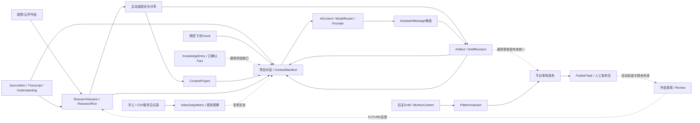

# V4.0 核心业务链路审计

审计日期：2026-10-10（Asia/Singapore）。对象：当前工作树，HEAD `242f7b911e369d4c93d0deccc02ee368cfd90137`。这不是 Governance Update，不改变 PRODUCT.md / ARCHITECTURE.md / LEGACY.md / AGENTS.md。

验证等级 **V0**：仅读取代码、配置样例、Schema、路由、测试定义及 Git 状态。未启动服务、未调用外部 Provider、未执行测试/typecheck/build、未查询或修改数据库，未运行 migration。存在大量既有未提交修改和未跟踪新模块，本轮包含它们，但不把历史 QA 报告视为当前通过结果。

证据强度：**确定**=代码直接可见；**风险**=存在条件性失败路径，未复现；**VERIFY**=静态扫描候选。矩阵“已完整实现”仅指所列狭义能力具备代码闭环，**不代表当前环境 API 调用成功或上线可用**。外部数据、模型、转录、队列、邮件等仍需配置和运行验收。

## 总体判断

**CURRENT IMPLEMENTATION**：通用文本创作核心链有真实持久化：输入→Conversation→Artifact/Revision→重开→继续改。研究到项目也有事务化分享路径，不能判成只能手动复制。**CURRENT IMPLEMENTATION GAP**：知识/事实供给、多Skill、通用scope、Artifact到审核发布、作品表现到持久Review反馈仍有断点。**FUTURE**：完整经营闭环未完成，不以本轮方案提前施工。

以下“交互有效”表示事件/请求/服务处理链已存在。**本轮未发HTTP请求，因此API实际调用成功、数据库当前写入和跨重启持久化、浏览器交互通过均为未验证**。测试源码有相应断言，不等于本轮执行结果。必须以该边界审阅本报告。

## 13步流程核对

| ID | 步骤 | 交互/API链 | 持久化数据 | 上下文传递与复制 | 结论/异常恢复 | 代码证据 |
| --- | --- | --- | --- | --- | --- | --- |
| B01 | 研究热点 | ResearchTrendList/Detail handlers与机会分析接口存在 | TrendSnapshot保存榜单窗口、观察时间；机会输出ResearchRun | 趋势引用/Opportunity研究；不是自动取代表作品 | 部分接通；A20资讯另有限权，外部Provider成功未验证 | `apps/web/server/research/trends.ts:19` |
| B02 | 拆解作品 | Teardown UI→startTeardown→队列→阶段worker | SourceItem/Asset/Transcript + ResearchRun coverage | 可复用原资料与报告；只支持当前协议的抖音输入 | 真实实现，依赖LLM/RedFox/ASR/Worker；retry/cancel有恢复 | `apps/web/server/research/teardown/service.ts:28`；`apps/worker/src/teardown/worker.ts:1` |
| B03 | 生成选题 | 对话TOPIC、ContentIdea、BenchmarkTopics、Opportunity多路径 | ContentIdea 或 ResearchRun，ContentTopic是另一审批域 | Idea.start或Research分享可入项目；不是唯一自动pipeline | 分支可用；A10两套选题、A23旧启动事务缺口 | `apps/web/server/discovery/service.ts:447`；`apps/web/server/benchmark-topics/service.ts:135` |
| B04 | 创建项目 | HomeComposer/Sidebar/Topic/Research sharing触发不同路径 | ContentProject/主稿/ProjectSource，部分带IP快照和幂等key | Research share带projectId/ArtifactId跳回dashboard | 已具闭环；A03/A16契约不统一 | `apps/web/server/project-service.ts:111`；`apps/web/server/research/sharing.ts:50` |
| B05 | 加载知识与资料 | MATERIAL引用真实正文；飞书在ContextBuilder自动授权检索 | Source/Transcript/Understanding/FeishuChunk；manifest记录来源版本 | KNOWLEDGE通用adapter unsupported，GENERAL_QUERY ownFacts空 | 部分接通；A04/A05；不把全部知识判为前端UI | `apps/web/server/assistant/references.ts:20`；`apps/web/server/ai/control/context-builder-v2.ts:274` |
| B06 | Agent生成内容 | POST assistant stream→AIControl→ModelRouter→provider.streamText | 先保存user/assistant占位，AIRun/manifest，终态保存文本 | Skill版本、模型、选定来源、任务锚点和近期对话进入prompt | 代码闭环；A02scope限制/A03只执行最多1个Skill；真模型未调用 | `apps/web/server/assistant/service.ts:233` |
| B07 | 对话修改 | targetArtifactId+editScope；server合并原文和替换片段 | 候选assistant消息保存sourceArtifactVersion；不自动覆盖成果 | 用户APPLY通过artifact revision API应用完整新正文 | 已接通；锁定/版本不匹配拒绝；失败保留原成果 | `apps/web/server/assistant/creation-policy.ts:34`；`apps/web/server/artifacts/service.ts:136` |
| B08 | 保存版本 | createTextArtifact、saveTextArtifact、apply修订和历史恢复 | Artifact身份+DraftBranch working +不可变DraftRevision | 消息与Artifact链接；源ResearchRun/Study可追溯 | 已接通；expectedVersion与事务；A26硬退出未保存编辑不能恢复 | `apps/web/server/artifacts/service.ts:111`；`apps/web/server/artifacts/service.ts:89` |
| B09 | 重新打开继续修改 | dashboard?project=&node=artifact: →loadWorkbenchPageData→ArtifactWindow | 数据库重新读正文与版本；assistant GET恢复任务引用和偏好 | 后续target同Artifact；最近80消息/100 revisions上限 | 保存内容可重开；A06材料逐轮/A19打开旧项目有初始化写/A25分页缺口 | `apps/web/server/workbench-page-data.ts:29`；`apps/web/components/projects/artifact-window.tsx:24` |
| B10 | 审核 | Fact确认、Topic审批、PlatformReview分属不同流程 | FactApproval/ContentTopicDecision/ReviewRecord | 旧平台稿可人工审批；Artifact lock只是内容确认 | A07：通用Artifact→平台Review没有统一桥接 | `apps/web/server/reviews/review-service.ts:82` |
| B11 | 发布 | PublishTask排期/导出包/复制/人工mark published接口 | PlatformVariant快照、母稿版本、externalUrl/id、审计 | 仅人工操作记录；未见完整平台授权自动发布实现 | 旧流程代码闭环；自动发布是FUTURE，通用Artifact未接 | `apps/web/server/publishing/publish-task-service.ts:76`；`apps/web/server/publishing/publish-task-service.ts:176` |
| B12 | 效果分析 | video-data日记录手工/CSV→前端账号级聚合 | VideoDailyMetric；真实works/audiences固定空 | PublishTask未自动生成VideoContent/作品快照 | A08/A22断点；有账号级基础，不能宣称作品闭环 | `apps/web/lib/video-analytics.ts:21` |
| B13 | 复盘复用 | 规则insight/复制文本；旧反馈/方法建议/Skill沉淀 | 本地insight未形成Review；CreationFeedback/MethodSuggestion局部有持久化 | 研究结论可share，经营复盘仍手工复制到项目 | A09：模型复盘→Review→下一轮Research/Artifact未形成；FUTURE | `apps/web/components/video-analytics-workspace.tsx:175`；`apps/web/server/learning-suggestions/service.ts:53` |

## 当前数据流（实线=静态链存在；虚线=缺口/后续能力）

## 重点一：输入资料

路径证据：`components/home-composer.tsx`、`lib/source-upload-client.ts` → `/api/source-items/upload` / `/api/source-items` → `server/source-upload.ts` / `source-service.ts` → `SourceItem` / `SourceAsset` / `IngestJob` → `apps/worker/src/ingest.ts` / `transcription.ts` → `Transcript` / `SourceUnderstanding` → `material-detail/readable-content.ts`。

- 文件上传/链接/文本具备真实处理路径，源数据不是固定Mock。实际接受类型、最大文件、授权与存储驱动仍需配置运行验收。
- 原文、ASR和机器理解有来源标记；来源不可读时返回缺口提示，不因source READY就认为有全文。
- 项目绑定用ProjectSource；assistant sourceItemIds在通用ContextBuilder中转MATERIAL引用后调用统一正文读取（context-builder-v2.ts:219–220）。0 Skill可工作。
- 当用户说“根据项目资料”但没有明确引用时，assistant-service按项目资料最多8条自动选取；超过8条要求手选。正文还有上下文预算，不等于整份超长PDF全部被读。
- **CURRENT IMPLEMENTATION GAP A06**：MATERIAL/sourceItemIds在发送后清空，跨轮恢复主要保留RESEARCH/ARTIFACT。不能承诺重新打开仍自动带原资料。若只需要逐轮语义，应明确UI；如果产品要求持续资料，需审核后改变任务引用契约。
- 失败恢复有IngestJob retry/cancel/队列对账和转录进度；拆解要求带时间戳，纯文本可读不等于该模块可拆解。

## 重点二：生成脚本/通用成果

`components/projects/studio-default-method.tsx:229` send → `/api/projects/[id]/assistant` → `server/assistant/service.ts:233` runProjectAssistant。先存USER/ASSISTANT占位并加对话锁；恢复旧task锚点和参数；读取Artifact/资料/研究/记忆；AIControl检查scope、fact、permission；ModelRouter选Provider；streamText产生delta；终态写Message/AIRun。

- 通用对话action=PROJECT_ASSISTANT/taskType=GENERAL_QUERY，不要求默认Method。旧GENERATE_MOTHER_CONTENT存在但只是兼容脚本流程。
- 新生成默认是**候选消息**；只有用户保存才创建Artifact。候选和已保存成果必须在UI标明。
- 真实LLM运行依赖有效IntegrationConfig；MOCK_MODE=true时存在Mock fallback。报告不以测试Provider的成功证明真模型成功。
- **A02**业务ScopeGate拒绝某些通用任务；**A03**创建至多1个Skill、项目设置至多3个、通用上下文显式singular参数或`.slice(0,1)`只拿一个，组合Skill尚未打通。
- **A04/A05**通用知识adapter未实现，通用ownFacts为空；飞书是独立授权供给，不可等同已接通所有FactRecord。
- 超预算会截断并警告/失败，token-limit输出标为未完成而非稳定成果；质量仍需真模型用例检查。

## 重点三：对话修改

`targetArtifactId`由服务端ArtifactContextAdapter解析真实内容；`editScope`附start/end/expectedVersion。Assistant检查锁定、版本和范围，生成片段后mergeLocalEdit拼回其余原文。保存候选metadata.sourceArtifactVersion，用户应用时ArtifactService再次检查版本、目标消息和来源归属。

连续局部修改还有baseProposalMessageId用于上一份未应用候选，防止第二次建议回退第一次改动；应用事务验证未选区域前后缀。`creation-agent.test.ts`中存在旧版本、连续局部修改、并发保存用例。**本轮未执行**这些用例，不能给质量/正确率承诺。

AI建议不会自动成为事实确认。CHECK卡片当前对文本做机械分行和统一MEDIUM标记（A24）；必须由Fact/Review服务执行真正确认。

## 重点四：保存成果与版本

保存候选：`POST /api/projects/[id]/artifacts` → createTextArtifact → Serializable事务创建DraftBranch、writeDraftRevisionInTransaction、Artifact、AssistantMessage关联、AuditLog。消息已关联时返回原Artifact，竞争关联失败不带入第二份成果。

手工保存：`PUT .../artifacts/[artifactId]` → saveTextArtifact → 权限、目标Project、deletedAt、primary branch隔离、locked、expectedVersion检查 → 追加Revision/更新working → 更新Artifact标题/审计。应用AI候选走`POST .../revisions`，锁定/解锁走PATCH。恢复历史走history POST读取旧revision再创建新revision，旧版本不被删除。

底层DraftBranch被Artifact复用，不另起ArtifactVersionV2。这是应保留的简化。旧主稿checkpoint会同步MotherContent供PlatformVariant兼容；不能把所有双份正文视为错误存储。

## 重点五：重新打开继续修改

`/projects/[id]` /studio redirect → `/dashboard?project=<id>&node=artifact:<artifactId>` → loadWorkbenchPageData → getArtifactForUser → ArtifactWindow/useArtifactEditor。正文来自数据库，beforeunload/未保存对话框保护浏览器编辑，焦点/定时刷新不会覆盖dirty内容；保存有409冲突提示。

对话GET按user私有Thread读取，恢复有效Research/Artifact引用及creationOptions；研究引用仍需权限/版本复核。项目Artifact是共享成果，私人原Conversation不能被其他成员直接读取。

边界：最近80消息/100修订无该接口分页（A25）；用户看到最近历史不代表旧数据丢了。首次打开旧项目触发primary branch初始化写入（A19），因此本轮不在真实库调用GET进行“只读验证”。

## 异常恢复与上下文断点

| 情况 | 当前保护 | 剩余风险/下一步 |
| --- | --- | --- |
| 外部素材采集/ASR失败 | DB任务、retry/cancel、进度、job-recovery | 真Provider错误与长视频分块仍需运行验证 |
| 研究/拆解队列投递失败 | DB reservation保留，teardown reconciler补投；version fence | 运维需验证Worker模式和终态；已完成报告刷新版本行为需保留历史口径 |
| LLM超时/停止/模型token上限 | catch保存partialContent并标FAILED/STOPPED；限token不标COMPLETED | A26：进程硬杀/断电绕过catch时，delta只在内存，不能承诺部分文本全部恢复 |
| 生成中重复点击 | advisory lock+Thread pending状态；超时记录清理 | 同一个Thread只允许一个运行；跨模式Thread行为待验 |
| 并发编辑/候选过期 | expectedVersion / sourceArtifactVersion / Serializable | UI保留编辑内容；需要重新载入或合并，不可静默覆盖 |
| 引用失效/越权 | ReferenceProject、private research、Artifact项目、飞书授权重查 | A11/A12个性读取还需负例验证；缓存不是权限边界 |
| 未保存手工编辑 | dirty guard、确认离开、beforeunload | A26：内存dirty不是持久草稿，浏览器崩溃/强制关闭可丢本次未保存内容 |
| 旧Idea启动中途失败 | 部分source已保存；idea已有project返回 | A23：整体非事务、重试/并发可能多建项目或少绑定来源 |
| 新闻后台失败 | news state有error/nextAttempt，调度catch降级 | A21：静默失败减少可观测性，不能用页面有缓存证明同步成功 |

## 从研究到项目，已接通与未接通的区分

ResearchUseFindings / WorkCreationAction → `/api/research/results/[runId]/share` 或 `/api/research/creation` → 选定结论/项目 → sharing.ts。已有事务化新建/复用项目和Artifact、来源过滤、版本校验与并发重试；共享快照和源私有报告不同，不自动覆盖原报告。因而这一段不需要反复复制文本。

旧ContentIdea → startIdeaProject是另一条路径，整体事务和幂等不足（A23）。Topic审批通过→topic.project能拷贝有效事实为EvidenceItem，但通用Assistant还未自动加载这一批已确认事实（A05）。

通用Artifact → Review/PublishTask **没有统一来源关系**；旧母稿→平台稿→人工Review→发布包是一条有实现的兼容链。PublishTask的scheduledAt不证明有定时平台发布；mark published只是人工记录。发布包不会自动形成VideoContent/作品快照/评论互动/持久Review。复盘UI规则文本要复制到项目（A09），这才是当前明确的手工搬运断点。

## 运行态验证清单（未执行）

正式证明“真正可用”应在LOCAL_TEST隔离库、独立Redis/存储下完成，再按明确授权进行LOCAL_REAL外部配置验收。最低核对：上传正文→关联→0Skill生成→保存Artifact→断开并重开→改指定段落→再次保存→旧version拒绝→历史恢复；以及跨Workspace/同空间其他用户私有研究、VIEWER写入、凭据和飞书撤权、锁定成果、任务硬崩溃恢复。逐步记录HTTP状态、scope、RunId、写入数据ID、版本、来源manifest与新会话读取。

不得从已有qa-reports/V3记录补填本轮“通过”。本轮完成静态链路审计后停止，运行验收随下一阶段任务审核授权。
