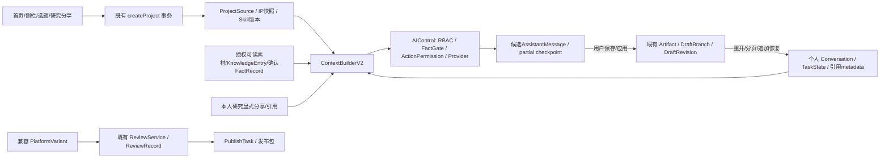

# V4 实施交付报告

2026-10-10。STATUS：READY_FOR_REVIEW（未暂存）。已完成本轮确认的权限、核心上下文、保存/历史/中断恢复、导航和基础创建收敛；全量V4最终验收未完成，不能宣称Release就绪。

## 授权与基线

S0读取六份审计与PRODUCT/ARCHITECTURE/LEGACY/AGENTS及Web规范，核对27问题和原78个tracked修改、241个untracked文件，保留HEAD 242f7b911e369d4c93d0deccc02ee368cfd90137。原门禁已由用户“继续”与后续明确个人scope答复解除；LOCAL_TEST白名单库重新核验后才运行集成测试。

个人范围决定：个人推荐只用本人创建的项目/选题/资料；MethodSuggestion仅owner查看处理；共享内容需明确加入。A26设计提交后，用户授权评估选择，选用既有AssistantMessage限频checkpoint并记录成本；不是Governance Update。

PRODUCT.md、ARCHITECTURE.md、LEGACY.md、AGENTS.md、apps/web/AGENTS.md的SHA256与S0完全相同。原重构提案仅追加实际审核实施说明，未修改治理规则。

## 阶段状态

| 阶段 | 本次实施与验收 | 证据/保留项 |
| --- | --- | --- |
| S0 | 基线确认/范围授权完成 | V4_S0_BASELINE.md，原工作树清单保留 |
| S1 | 权限修复PASS | 58项阶段测试；负向先复现；V4_S1_REPORT.md |
| S2 | 核心契约PASS | 阶段75项；通用scope、Skill、知识/事实、持续引用；V4_S2_REPORT.md |
| S3 | 选题事务、历史、checkpoint PASS | 38项；真实专用worker硬杀后读库恢复；V4_S3_REPORT.md；外部模型/Redis NOT RUN |
| S4 | 核心导航/界面PASS | SSR13、旧审核等43、真实Web浏览器1；V4_S4_REPORT.md；全量旧URL未覆盖 |
| S5 | 基础编排/编辑契约/报告层收敛PASS；全领域精简有保留项 | 创建60项、格式器3项，Web/Worker类型通过；V4_S5_REPORT.md；A17/A14/按需数据加载未全面解决 |
| S6 | 只读候选核查 | 13个UI；无删除授权、未删除；V4_S6_DELETION_CANDIDATES.md |

阶段次数有重叠，不累计为完成率。每次失败均停在本阶段定位和安全修复后才继续；环境失败、Mock结果和外部NOT RUN在测试报告分开记录。

## 核心实际变化

个人读取与创建权限在服务端收口；通用对话不受旧口播业务分类限制。项目创建/编辑/执行使用零至三个授权Skill，所有选中版本可追溯，实际激活按原resolver/预算。KnowledgeEntry与有效FactRecord通过当前授权素材读取接入，外部知识不转为企业自身事实。

持续资料用明确范围、ID和版本保存；资料变化或失效拒绝静默沿用，重新打开恢复持续引用。AI生成、指定段落候选、应用修订、保存、版本冲突、锁定、历史恢复沿用现有Artifact/DraftRevision；未创建平行版本系统。

消息80/成果历史100只是默认窗口，现在可分页读完整历史。流式消息每5秒检查且增长1KB才checkpoint，终态前收口在途写入；硬故障最多恢复到最后成功保存的片段，未完成不会当正式成果。人工未保存编辑仍只提供dirty导航保护。

五主导航：首页、项目、资料、研究、Skill。默认项目上下文/Conversation/Artifact同时呈现；Canvas、MotherContent、平台稿、GPT兼容流程降到高级入口。资料/知识/事实各自数据权限保持；研究各模式与分享事务保留，资讯按原授权显示。

/content-review核实为选题审批，主入口取消、旧URL跳转/topics?view=review；ReviewRecord平台稿审核保留对应项目及历史。普通创作不强制选题审批，旧审批转换仍遵守既有规则。Artifact锁定/AI CHECK不等于正式人工批准；没有新通用审核系统。

## 27问题处置

| 编号 | 本轮结果 | 实际边界 |
| --- | --- | --- |
| A01 | 已修复默认入口 | 真实任务首页替代initialDemo运营首页；旧运营保留 |
| A02 | 已修复 | GENERAL_QUERY无旧内容正则拦截，安全门保留 |
| A03 | 已修复契约 | 0–3授权版本统一，加载/激活/冲突/预算分开 |
| A04 | 已适配 | 授权KnowledgeEntry及可读来源接通，非整个知识库自动加入 |
| A05 | 已接通定向事实 | 只供当前授权、确认、有效事实，不把外部内容当自有事实 |
| A06 | 已实现显式范围 | ID/来源版本/TURN-TASK-PROJECT持久化；重开/版本失效及持续引用负例PASS |
| A07 | 暂缓目标 | 通用Artifact到正式审核/发布未新增；保留平台ReviewService链 |
| A08 | 保留缺口 | 没有真实作品级数据和画像；不伪造，不新建经营域 |
| A09 | 保留缺口 | 旧运营规则观察仍不是真实LLM复盘；首页不默认加载 |
| A10 | 入口调整，数据保持 | ContentIdea与ContentTopic职责有差异，未合并表/审核状态 |
| A11 | 已修复 | 用户批准个人范围；仅本人项目/选题/资料，公开趋势保留 |
| A12 | 已修复 | owner列表/决定/去重隔离，兼容本人旧去重键 |
| A13 | UI已改，loader仍有缺口 | 默认Conversation+Artifact，高级Canvas；旧聚合数据按需加载尚未全部处理 |
| A14 | 局部修复 | 实测浮动遮挡已修，新增布局有域选择器；历史全局叠加尚未全面收敛 |
| A15 | 兼容模式保留 | Web/Worker模式锁不改，两端typecheck通过；嵌入执行依赖仍在 |
| A16 | 已修复权限与收敛 | 三条基础创建复用现有createProject/事务，保留应用编排 |
| A17 | 未实施全面职责迁移 | 可读素材/授权引用已复用；旧MaterialAnalysis/Distillation研究编排仍在资料详情，待单模块收口 |
| A18 | 仅核查 | 13候选静态复核，无运行日志/外部动态消除证明；删除0 |
| A19 | 安全加固，兼容风险保留 | 事务内权限与advisory lock；GET惰性初始化及VIEWER语义未改治理规则 |
| A20 | 入口已修复 | 资讯按原requireNewsActor服务端结果显示，不改变实验访问政策 |
| A21 | 风险保留 | 终态及checkpoint存在；心跳写入失败降级仍无独立告警，未全局重构可观测性 |
| A22 | 保留数据约束缺口 | 运营projectId仍无外键；未迁移或清除数据 |
| A23 | 已修复 | Idea创建/全Source/关联/Audit同事务，锁后重查幂等，并发及回滚PASS |
| A24 | 候选定位保留 | AI CHECK不等于事实或人工审批；未开发事实核验新框架 |
| A25 | 已修复 | 80消息/100修订向前分页接API/UI，161/201完整回归 |
| A26 | 已实施批准的最小恢复 | 复用消息限频checkpoint；真实专用worker SIGKILL恢复PASS，不替代Artifact保存 |
| A27 | 已收敛目录边界 | 纯报告函数在lib单实现，原components兼容re-export，API不依赖UI目录 |

## 数据流与复用边界

没有给通用Artifact虚构平台审核/发布映射。原研究私人对话不会因Project共享而自动公开，分享沿用明确事务快照。

## 数量与实际处置

功能盘点96项（92当前+4目标/FUTURE）；当前能力均保留，业务功能删除0。原价值建议59保留/15合并/15降级/3当前暂缓+4目标暂缓继续用于审阅，不冒充已完成的合并数量。实际入口/编排收敛：五主导航、选题审批入口、三条基础创建；实际降级：Canvas/旧主稿/平台兼容高级视图、资讯按授权。后台API/Prisma模型/用户数据删除0。

原17静态导航目的地→5，减少12；动态最近/文件夹不计一级模块。两套重复基础项目初始化改为委托现有ProjectService；UI与API共用一个纯报告格式器；成果嵌入/弹窗共用同一编辑契约。原13UI候选1045行未删除，不给全仓重复代码节省百分比。

## 验证与关键文件

最终220个不同用例通过（核心203、导航13、真实浏览器1、格式器3）；Web/Worker typecheck PASS。完整命令、C01–C16结果、失败原因、修复路径、截图与真实实体证据见 V4_TEST_REPORT.md。九类中文固定样本已保存，真实生成与人工评价NOT RUN，Mock不替代质量验收。

关键文件：server/project-service.ts、sidebar/basic-project.ts、content-governance/service.ts、discovery/service.ts、learning-suggestions/service.ts、recommendations/context-builder.ts、ai/control/{scope-gate,context-builder-v2,ai-control-service}.ts、assistant/{service,references}.ts、artifacts/service.ts、drafts/service.ts、components/{sidebar-foundation,app-shell,content-hub}.tsx、projects/{studio-shell,studio-default-method,artifact-window,artifact-editor,use-artifact-editor}.tsx、lib/contracts/{creation,references,assistant}.ts、lib/work-research-markdown.ts及对应API/page。详细前后行为见阶段报告和V4_CHANGELOG.md。

## 未完成、风险与下一步

真实中文质量、真实Provider/飞书/ASR/平台服务、真实文件上传解析、真实模型超时/Redis故障、并发HTTP409与全量浏览器后退/旧URL验收仍NOT RUN。需要明确的真实服务/费用授权后再运行，不用生产凭据试错。

S5仍有资料详情深度编排A17、全局CSS完整收敛A14、默认loader按需旧数据A13、A19兼容读取写入政策和A21告警等保留项；没有用“已改UI”代替这些架构缺口。后续按领域小diff收口，避免全仓迁移或额外Runtime。C01–C16有PARTIAL项，先完成这些验收再决定Release。

Next启动隔离服务自动更新原本已修改的next-env.d.ts类型路径；未提前保存原内容，未猜测还原，单独列为交付风险。已添加独立编译目录忽略并关闭测试服务；下次正常Next启动会按对应distDir生成类型文件，人工审阅时不要把该生成改动与业务代码打包。

早期事实夹具失败可能留下隔离库UUID数据；最终事实测试按归档/停用保留确认历史，未删除审批记录或移除约束。

## Git与回滚

未git add/commit/push/pull/merge/rebase/reset/stash/clean，未切分支，未migration。报告及代码待人工审核；git diff混合原任务改动，只可逐hunk审阅本轮授权变化，不允许整仓暂存。回滚用本阶段反向补丁保留用户原工作和新增确认历史，不放宽权限。实际删除S6候选仍需单独批准。
