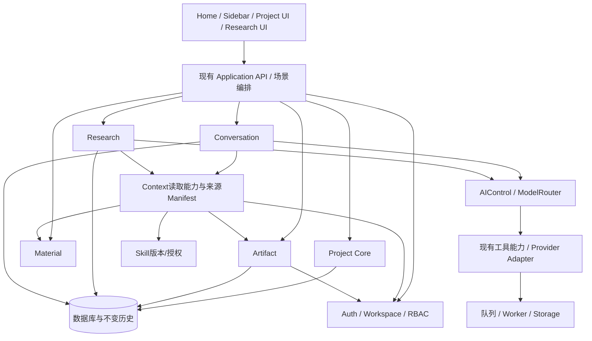

# V4.0 代码与功能架构收敛方案

审计日期：2026-10-10（Asia/Singapore）。对象：当前工作树，HEAD `242f7b911e369d4c93d0deccc02ee368cfd90137`。这不是 Governance Update，不改变 PRODUCT.md / ARCHITECTURE.md / LEGACY.md / AGENTS.md。

验证等级 **V0**：仅读取代码、配置样例、Schema、路由、测试定义及 Git 状态。未启动服务、未调用外部 Provider、未执行测试/typecheck/build、未查询或修改数据库，未运行 migration。存在大量既有未提交修改和未跟踪新模块，本轮包含它们，但不把历史 QA 报告视为当前通过结果。

证据强度：**确定**=代码直接可见；**风险**=存在条件性失败路径，未复现；**VERIFY**=静态扫描候选。矩阵“已完整实现”仅指所列狭义能力具备代码闭环，**不代表当前环境 API 调用成功或上线可用**。外部数据、模型、转录、队列、邮件等仍需配置和运行验收。

## 方案定位

本方案遵循既定PRODUCT PRINCIPLE：以项目为长期容器，以Conversation持续协作，使用Material、Research、可选Skill与Tool，形成可保存并继续修改的Artifact。V4.0是用户本次审计方案名称；不改应用版本、不宣布发布、不把方案升级为治理规则。

目标是修复CURRENT IMPLEMENTATION GAP，保留稳定代码及历史数据。先把关键链路和scope做对，再简化入口、拆编排；不为了“架构漂亮”重新建服务/数据库或增加Agent框架。完整经营域、License、桌面交付均维持FUTURE，下一阶段要单独模块任务。

## 简化应用导航

当前17个静态主导航目的地可收敛至5个（少12，约71%）。动态最近项目、文件夹、账户/设置/系统管理不计入这一口径；它们保留。页面深链接与旧URL兼容可继续存在，不需要同步删路由。

| 一级入口 | 主职责 | 二级/上下文内容 | 当前路由映射 |
| --- | --- | --- | --- |
| 首页 | 找工作、创建项目、快速开始、回到最近工作 | 最近项目、快捷附件/模型/Skill，授权时的少量研究提示 | /home；复用WorkbenchStart/HomeComposer与最近项目读取 |
| 项目 | 完成持续协作，查找/组织现有项目 | 项目库；工作区；选题候选/可选审批；项目相关审核/发布记录 | /projects → /dashboard?project=；保留/projects/[id]兼容 |
| 资料 | 原始输入读出来、管理和供给 | 原文/附件/转录；知识条目；事实确认；飞书授权资料；背景信息 | /library；/knowledge；/knowledge/facts；/library/feishu；/ip-context旧链继续可读 |
| 研究 | 主动比较、分析、验证、综合 | 开始研究、作品拆解、老师/对标、热点/资讯、历史、来源 | /research；new/teardown/benchmarks/trends/results/sources/works/focus |
| Skill | 管理可选专业能力 | 导入、版本、启停、专业方法沉淀 | /library/methods/**；项目内选择可0个或多个 |

运营入口保留为二级快捷目的地或授权账户菜单：运营看板、今日任务、手工数据、发布日历；不把FUTURE经营域删掉，也不在本阶段扩大。资讯日刊在“发现”内按当前本人授权限制显示，若改团队访问必须明确批准访问政策。

顶部栏建议：全局搜索、当前项目名称/面包屑、视图切换、帮助。项目未保存状态在编辑器显示；模型/Skill/输入资料在composer贴近任务；业务保存/审核/导出在成果上下文。顶栏“视图/窗口”合为视图菜单；文件快捷菜单保留开始/打开/资料快捷动作。编辑命令只在目标存在时出现，避免指向不存在workbench-idea。

## 页面布局

### 首页

上部任务输入与附资料；模型和可选Skill在发送区；下部最近项目/全部项目。Home不承载运营数据管理或完整研究列表。没有选择Skill时按钮正常可用；提交先创建项目再启动Conversation，失败有明确项目ID/状态与可继续入口。

演示运营看板仅在明确演示入口显示，来源标识持续可见。普通首页不自动进入DEMO；不把空真实数据替换为演示数值。复用现有createVideoDemo隔离，不重写演示数据服务。

### 项目工作区

```text
应用侧栏：项目快捷项/文件夹
项目标题与目标：编辑信息、更多
主工作区：Conversation持续对话
右侧或可折叠成果区：Artifact列表 + 当前成果编辑/版本/导出
上下文区：本轮资料 / 持续引用的研究与成果 / 已确认事实 / 可选Skill
高级视图：Canvas、旧主稿、平台适配、兼容GPT交换
```

每个成果编辑器只有一个dirty与版本状态所有者；Conversation保持可见，局部修改指定目标Artifact和版本。生成消息是候选；保存/应用后才成为成果。历史、恢复、锁定提示保留；锁定不冒充人工Review批准。

Canvas默认降为可选高级视图，不能因此删CanvasObject或节点对话。初期仍使用dashboard现有路由，先换宿主布局后再考虑路由命名。重构从loadWorkbenchPageData的必要查询开始，不必每次加载默认Method/平台/Canvas全部数据。

### 资料页

列表负责添加/查找/标签/集合/处理状态；详情负责原文、附件、转录/提取状态与来源、基础管理。深度理解、提炼、对比以“开始研究/加入研究”动作进入Research，历史MaterialAnalysis/Distillation仍有只读入口和来源版本。

知识和事实是资料上的治理视图，但服务职责独立：条目修订/保密、声明来源/双身份确认/有效期都不可被UI合并抹掉。飞书授权信息与连接版本可见；不能执行正文内的指令，也不能自动当我方已确认事实。

### 研究工作区

一个容器：模式选择 → 对象/问题 → 运行阶段与覆盖范围 → 结论/证据/局限 → 保存或主动分享到项目。作品、账号、机会、Focus保留特有采样和分析逻辑；来源与历史为子视图。不同来源计算不强统一口径，不新增ResearchRuntimeV3。

分享保留用户挑选/改写、source provenance与版本，继续用现有sharing事务，不把私人原报告复制给所有成员。关联projectId通过引用/操作传递，入口切换保留原项目上下文和返回位置。

### 运营与审核

保留手工CSV/日记录/运营任务及旧发布包。分别明确：内容审核中心是选题审批、平台Review是稿件审核、FactApproval是声明确认。新的统一审核页如需新增，应先复用这些状态和服务，不直接合表。运营“AI复盘”当前改为规则数据观察的准确命名；真正模型复盘只列后续模块验收。

## 代码边界：先复用，后抽取

| 目标职责 | 复用当前代码 | 要收敛的责任 | 不做的提前扩张 |
| --- | --- | --- | --- |
| ProjectCore | sidebar/basic-project、project-service、db/projects | 权限归属、基础CRUD、主容器；最小事务与幂等 | 不把附件、Skill、研究分享全部塞createProject |
| 开始工作编排 | HomeComposer/WorkbenchStart、createProject已有transaction参数 | 创建项目+附件+配置+初始任务，失败补偿与可继续 | 不新增ProjectV2、StartRuntime |
| Conversation | assistant/service、task-state、memory、流式route | 持续任务、候选消息、恢复、引用；减少旧Canvas/母稿动作依赖 | 不让Conversation直接操作Artifact内部Revision |
| Artifact | artifacts/service、context-adapter、drafts写版本原语 | 成果身份、权限、正文/版本/锁/历史；应用候选 | 当前先TEXT，未来类型不为本轮造泛型框架 |
| Material | source-service/upload、readable-content、worker采集/ASR | 原始读取/管理；统一可读正文和来源版本 | 深度研究不继续堆详情Service |
| Research | research/service/access/read-model/sharing、各模式contract/evidence/analysis | 同生命周期/授权/来源/保存外壳；模式分析独立 | 不以某Provider命名Research；不删旧Study结果 |
| Skill | methods、project-methods、skill-resolver | 可0/多选、版本/授权/边界、冲突提示与激活 | 不强制Default Method，旧fallback仅兼容 |
| Context | ContextBuilderV2、references、Artifact/Material/Feishu adapter | 统一scope、版本、ownership、预算与来源manifest | 不把它变成所有业务大Service |
| 基础工具 | existing web-search/media-link/provider/worker | 稳定能力调用接口、输入/输出、权限与错误 | 统一ToolRegistry缺口记录，不先建设插件生态 |
| 发布/运营兼容 | PlatformVariant、Review、PublishTask、video-operations | 旧链保留，显式来源版本及手工模式 | 不提前实现FUTURE自动经营与License |

新增Service/Adapter前要搜索上述等价能力。Project创建的最小能力可从已有basic-project与createProject合并而来，但要先解决基础权限/停用一致性和IP snapshot策略，不按名称决定谁覆盖谁。项目作用域与个人数据作用域不同，不能仅以workspace共享权限通读所有私人上下文。

## 目标调用关系



Conversation请求ArtifactService执行保存/应用；Research共享也调用成果边界，逐步减少直接操纵内部Draft结构。UI只处理交互和可见状态，不拥有多域事务/安全政策。

## 数据权威与上下文贯通

1. ContentProject是长期scope与目标；项目目标、用户明确任务和本轮覆盖需求保持分离。API携带projectId，服务端重查workspace归属与角色。
2. AssistantThread/Message保存协作，taskState保存当前任务锚点与更新，引用保存对象ID+来源版本+本轮或持续用途；UI关闭不以localStorage正文作为权威。
3. Material正文通过readable-content唯一选择来源；原文、Transcript、机器理解有不同provenance，不把加工文本伪装原始事实。
4. Research保存输入范围、问题、来源快照、计算/AI标记、覆盖率和局限；分享Artifact是用户选择的快照，私人Run仍私有。
5. Artifact身份与DraftBranch/Revision复用，expectedVersion防止静默覆盖；旧MotherContent仅primary投影。确认/锁定不能强行等同审核/发布状态。
6. KnowledgeEntry、FactRecord、EvidenceItem用统一读取契约协作但不直接合表；失效、保密、争议、我方/外部身份约束在服务端。
7. 用户Profile是登录用户的表达偏好；VideoAccount/BenchmarkAccount/auth Account不同。未来CreatorAccount需要独立业务scope和第三方credential关系。
8. 浏览器偏好、新闻公共缓存、记忆检索缓存均可丢弃重建；业务成果和审核留痕不可丢。

### 将来经营闭环（只设计依赖）

FUTURE：Artifact revision → Publishing → PublishedWork → MetricSnapshot/Engagement → Review → 可分享的Research/Skill/新项目输入。CreatorAccount标记实际平台账号，User仍产品登录账号。MetricSnapshot要含观察时间、来源、口径、缺失和版本，不能以VideoDailyMetric替代作品级数据。现有PublishTask和手工Video台账是兼容基础，未来以适配/映射迁移，不本轮改Schema。

### 本地优先桌面（只登记缺口）

保留现有本地目录与Provider可替换性；当前仍Web/PostgreSQL/Redis/Worker形态。本机文件服务不等于用户设备桌面应用完成。Credential Store、Desktop File Bridge、Local Runtime管理、备份恢复、License均维持FUTURE；不以V4审计为理由重写全产品。

## 审核决策清单

- 核准5个主入口与运营二级的摆放；默认工作区Conversation+Artifact、Canvas为高级视图。
- 核准资料逐轮/持续引用的产品语义、可选Skill数量与执行组合契约；这些只补实现差距，不推翻既定可0或多个原则。
- 明确KnowledgeEntry/FactRecord/EvidenceItem和个人推荐/方法建议的可见与模型可用范围。
- 先处理高风险scope与重开/保存链；旧UI候选仅专项确认删除，后台/表/历史数据暂不删除。
- 真模型、Worker、ASR、飞书、邮件的运行验收使用隔离环境；经营域/桌面/License另起经审核的模块任务。

当前仅提出供审核的方案。没有改变业务路由、菜单、服务、Schema、配置、用户数据或治理文档。实施阶段见 V4_IMPLEMENTATION_PLAN.md。

## 2026-10-10 执行追加：审核定位与已实施边界

依据用户后续实施授权与成稿审核追加决定，五主导航、默认Conversation/Artifact、个人权限、核心上下文与基础创建编排已修改，见 V4_EXECUTION_REPORT.md 和阶段报告。/content-review已核实为选题审批并兼容跳转/topics?view=review；平台稿ReviewService/ReviewRecord及历史继续在项目上下文，通用Artifact没有正式人工审核桥接，未新增第二套审核系统。旧ContentTopic转换的评分/批准约束保留，不强加到零Skill普通项目。A17资料深度编排、全局CSS彻底收敛与按需旧数据加载仍有缺口；本追加不把原方案全部标为完成，也不修改权威治理规则。
