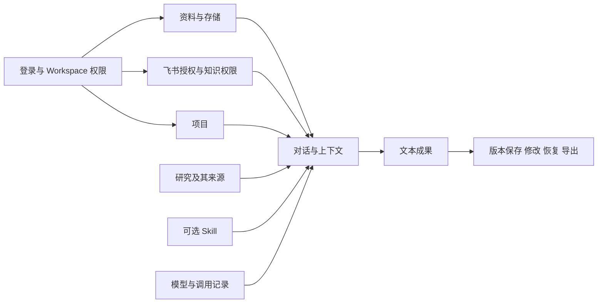

# 鑫世界 AI 工作台｜功能架构展示与产品取舍决策方案

现有系统功能盘点与管理层评审底稿，2026-10-10。

鑫世界已经具备项目、对话、资料、研究、技能和文本成果的实现基础，但尚不能据源码数量判断交付完成度。当前产品原则是“以项目为长期工作容器的通用 AI 工作台”。教培内容创作适合作为现场演示场景；经营数据、商业交付和桌面化属于后续明确任务，不能因本次汇报提前展开。

本次最需要管理层区分的是三个问题：既定产品方向是什么，当前系统实际包含什么，以及下一版应交付哪些已验证能力。尤其不能将演示首页图表、规则摘要或平台数据适配代码当成真实经营效果。

## 盘点范围与证据边界

- V0 静态盘点：读取权威规则、导航、主要页面、服务、Agent 编排、Prisma Schema、Provider 和相关测试文件；系统提取全量页面文件、API 文件、控件源码位置及服务导出声明。
- 基于当前工作树，包含大量既有未提交改动和未跟踪实现；不等于某个已发布版本。关键源码 SHA256 存于实现索引 JSON，可识别后续变化。
- 最后一轮哈希核对发现 `artifacts/service.ts`、`assistant/creation-policy.ts`、`assistant/prompt.ts`、`assistant/service.ts` 在盘点期间继续变化。重新读取后，本文关于文本成果、版本保护、创作策略、局部修改和来源的结论仍有对应代码；初始索引中的行号及摘要属于较早快照，不能视为最终固定版本。变化登记见 [一致性检查](verification.json)。
- 未启动应用、未操作真实页面、未运行测试、未查询数据库内容或 migration 执行状态、未调用模型或第三方接口、未读取真实密钥配置。因此不使用“已完成”作为本轮验收结论。
- 全量索引证明文件与声明存在；主要路径有人工语义核对。其余接口、所有动态 UI 分支和每个按钮的运行效果仍需逐模块验收，不能把静态提取说成全部功能实测完成。

| 静态资产 | 数量 | 解释 |
| --- | ---: | --- |
| 页面文件 | 82 | 含重定向、动态与设置拦截页面，不是 82 个独立功能 |
| API Route Handler 文件 | 196 | 不等于 196 个已验收接口 |
| 控件源码位置 | 921 | 同一行可能含多个控件，动态生成不展开，不是按钮数量 |
| 服务与适配器文件 | 337 | 覆盖 Web server、Worker、integrations、providers，排除测试文件 |
| Prisma model | 89 | Schema 声明，不证明存在已部署表或真实数据 |
| Prisma enum | 56 | 类型声明 |
| 测试文件 | 303 | 资产登记，不是本次通过结果 |

完整入口和源码链接见 [现有实现索引](implementation-index.md)；机器可读引用、行号、源码摘要、文件哈希和 Git 状态见 [实现快照](implementation-inventory.json)。

## 产品全景与候选方案的差异

权威依据为 [PRODUCT.md](../../../PRODUCT.md)、[ARCHITECTURE.md](../../../ARCHITECTURE.md)、[LEGACY.md](../../../LEGACY.md)。本次不是 Governance Update，不修改这些规则。

| 视角 | 权威状态 | 汇报应采用的表述 |
| --- | --- | --- |
| Project、Conversation、Material、Research、Skill、Artifact | PRODUCT PRINCIPLE / TARGET ARCHITECTURE | 六个一级核心对象，项目承担持续工作 |
| 首页与侧栏 | PRODUCT PRINCIPLE | 找到工作、创建项目、回到最近工作；侧栏是导航外壳 |
| 内容创作与教培脚本 | 场景与 CURRENT IMPLEMENTATION | 可作为价值演示，不将固定口播流程提升为通用产品中心 |
| 内容发布与经营数据闭环 | FUTURE，已有局部代码 | 是正式后续规划；已有发布任务和对标观察不等于完整经营域 |
| 多机构商业交付、席位、设备、License | FUTURE，已有 Workspace / User 基础 | 不将现有成员管理等同于完整商用授权 |
| 本地优先桌面交付 | TARGET ARCHITECTURE，当前存在实现缺口 | 当前 Web、数据库、文件存储与 Worker 基础不等于已交付桌面产品 |
| Studio、MotherContent、Default Method、Canvas | LEGACY COMPATIBILITY / VERIFY 等 | 保留兼容事实；是否处置须另行依赖核对，不授权直接删除 |

原 8 板块清单可以作为评审分类，但遗漏了通用研究、可选组合技能和通用成果作为一级对象的产品职责。首页驾驶舱、固定口播产品中心、多岗位经营平台也不能自动取代已确定定位。

## 当前菜单与实际入口

菜单证据：[SidebarFoundation](../../../apps/web/components/sidebar-foundation.tsx)、[研究导航](../../../apps/web/components/research/navigation.ts)。导航标签只代表入口，具体对象和成熟度见下节。

| 导航 | 当前入口 |
| --- | --- |
| 首页 | `/home` |
| 工作台 | `/dashboard`，项目为 `/dashboard?project=<id>` |
| 内容创作 | 今日任务 `/short-video/tasks`；项目管理 `/projects`；选题中心 `/topics`；内容审核 `/content-review` |
| 知识与资料 | 资料库 `/library`；知识中心 `/knowledge`；事实确认 `/knowledge/facts`；创作方法 `/library/methods`；IP 背景 `/ip-context` |
| 研究与洞察 | 开始研究 `/research/new`；作品拆解 `/research/teardown`；老师/对标 `/research/benchmarks`；热点趋势 `/research/trends`；资讯日刊 `/research`；研究记录 `/research/results` |
| 研究页内入口 | 已保存来源 `/research/sources`；对标新作 `/research/works` |
| 最近项目 | 按用户项目偏好和文件夹组织；当前项目还提供“从此项目开始研究” |
| 账户菜单 | 我的账号、设置、成员与权限；系统管理员另有 `/admin` |
| 其他路由 | `/short-video` 数据页、飞书资料、发布中心、旧 Discovery/Studio 等；不因存在路由就视为当前一级产品中心 |

`/projects/[id]` 重定向到 `/dashboard?project=<id>`，不是独立项目编辑器。`/dashboard` 无项目时显示开始工作入口；有项目时加载 StudioShell。当前首页职责和旧工作区并存属于 `CURRENT IMPLEMENTATION GAP`。

## 主要功能与实现链路

| 领域 | 页面与操作证据 | API 或服务 | 主要持久对象 | 当前边界 |
| --- | --- | --- | --- | --- |
| 项目 | 创建、搜索、分类、最近打开、归档与恢复 | project-service、sidebar/service；API 逐项见索引 | ContentProject、ProjectFolder、UserProjectPreference、ProjectSource | 创建同时处理资料、技能、模型和 Brief，基础能力与入口编排仍耦合 |
| 对话 | 发起任务、多轮补充、停止/失败状态、重试与保存结果 | assistant/service、项目 assistant API、AIControlService | AssistantThread、AssistantMessage、AIRun、ApiUsage | 有项目和用户范围检查；不能由局部路径推断全域安全 |
| 资料 | 入库、上传、转录、详情、重试、资料引用 | material-detail、Source Provider、Worker transcription | SourceItem、SourceAsset、Transcript、IngestJob | 详情仍组合 MaterialAnalysis / MaterialDistillation，研究职责未完全收敛 |
| 研究 | 开始研究、记录、来源摘录、分享和项目衔接；拆解、对标、趋势、日刊有实现文件 | research/service、research 子模块、Discovery 服务与 Worker | ResearchSession、ResearchRun、BenchmarkAccount、BenchmarkContentSnapshot、TrendSnapshot 等 | 各垂直模式与旧 Discovery 并存，不宣称统一通用 Research Runtime 已完成 |
| 技能 | 任务类型、专业技能、版本选择与运行使用状态 | skill-resolver、context-builder-v2、Method 服务 | MethodAsset、MethodVersion、ProjectMethodSelection、MethodUsage | 0 Skill 可工作是产品原则；Resolver 的提示/建议不等于完整自主工具调度 |
| 成果 | 保存为成果、保存修改、AI 修改选区、导出已保存版本、查看历史、恢复、锁定/解锁 | artifacts/service、artifact-editor、成果及 history API | Artifact、DraftBranch、DraftRevision | 通用 Artifact 目前仅 TEXT；仍复用稿件分支并与 MotherContent 并存 |
| 知识治理 | 知识条目、事实确认、保密级别、选题审核、IP 背景版本 | content-governance/service | KnowledgeEntry、FactRecord、FactConfirmation、FactApproval、ContentTopic 等 | 不是简单“一个知识库检索按钮”；权限、确认和版本不可忽略 |
| 数据与运营任务 | 账号登记/归档、手动记录、CSV 预览/保存、内容阶段、任务分配/延期/完成 | video-operations/service、video-analytics-workspace | VideoAccount、VideoDailyMetric、VideoContent、VideoTask | 基于人工/CSV 数据；不是平台实时接入，也不是完整 CreatorAccount 经营域 |
| 发布兼容 | 平台内容人工审核、发布快照、排期、取消、手动标记已发布 | publishing/publish-task-service | PlatformVariant、ReviewRecord、PublishTask、MotherContent | 记录发布状态不等于自动发布；旧发布包依赖母稿和审核状态 |
| 管理 | 会话、成员、模型配置、调用用量、存储诊断 | access、integration、admin/usage、local-storage | User、Session、Workspace、WorkspaceMember、IntegrationConfig、AuditLog | 凭证/角色有基础；成本账单、完整备份、License 与桌面交付不能宣称完成 |

这些均为 `CURRENT IMPLEMENTATION` 的代码观察，只有对应工作流在隔离环境跑通并满足验收条件后，才能转述为“已交付可用”。

## 演示数据和真实数据

### 首页来源展示缺口

[home/page.tsx](../../../apps/web/app/(app)/home/page.tsx) 返回 `<VideoAnalyticsWorkspace initialDemo showDataSource={false} />`。组件在 demo 模式使用 `createVideoDemo`，不读取真实运营记录。`showDataSource={false}` 还会隐藏模式标识、切换按钮和部分来源说明，并影响导出、复盘复制中的演示标识。

这属于 `CURRENT IMPLEMENTATION GAP`。管理层汇报必须明确标为演示页面；不能以首页数字说明播放增长、招生转化或客户使用效果。本轮只登记，不修改组件。来源标识应作为独立后续任务核对页面、复制和导出路径。

### 数据页与规则摘要

`/short-video` 默认不启用 demo，可按 `demo=1` 进入样例模式。真实模式中的“真实记录”表示读取数据库已录入记录，不代表自动来自平台，也不保证人工录入无误。

[video-operations/service.ts](../../../apps/web/server/video-operations/service.ts) 保存数据来源、数据截至时间、版本、完整日标记和覆盖率，支持手动或 CSV；账号同日期记录可更新。人工限流标记不能被低播放量推断替代。

[video-analytics-workspace.tsx](../../../apps/web/components/video-analytics-workspace.tsx) 明确说明演示分析和真实模式摘要未调用真实模型。汇报中“AI 领航”应解释为规则摘要展示，不能宣称已完成模型驱动经营复盘。

### 第三方集成

| 能力 | 源码基础 | 现场验证条件与成本驱动 |
| --- | --- | --- |
| 飞书 Wiki / Docx | 连接、浏览、订阅、同步、chunk 检索、授权范围与原文引用 | 获授权的测试空间、连接有效、外部调用允许；关注撤权、失效、限流和更新时效 |
| LLM | Kimi / DeepSeek 模型目录和 OpenAI compatible Provider 基础 | 对应模型与 Key 可用；按实际 token 和供应商账单测成本，不能以用量页代替账单 |
| RedFox | 视频来源、对标、趋势等适配代码 | 实际服务权限、接口稳定性、数据采集时间；不据此承诺小红书竞品实时监控 |
| 转录 | 豆包录音文件/流式相关适配、本地 FunASR、FFmpeg 处理 | 运行模式、模型和硬件、媒体格式；测耗时、错误、长媒体恢复与成本 |
| 联网检索 | WEB_SEARCH 系统配置、Exa 接入及 assistant-web-search | 外部调用开关、凭证、来源可追溯性；检索成功不等于事实全部可靠 |
| 存储 | 本机文件、MinIO / S3 compatible 等适配 | 当前部署驱动、访问范围、文件一致性；目录搬迁或恢复默认位置不是备份恢复 |
| 发布 | 发布任务、外部平台入口、手动完成记录 | 未确认平台 OAuth 自动发布闭环；发布时需人工在平台核实 |

依据：[Provider 策略](../../../packages/integrations/src/system-provider-policy.ts)、[Provider 导出](../../../packages/providers/src/index.ts)、[飞书 Context](../../../apps/web/server/knowledge/feishu-context.ts)。未调用第三方服务，不给接口当前价格或可用率作结论。

## 85 项候选清单比对

[功能决策明细](feature-decisions.md) 包含功能说明、当前观察、业务价值假设、依赖、相对成本、建议和上级决定空栏。[结构化评审记录](feature-decisions.json) 另含实际效果、权威状态、证据路径、负责人、验收和执行授权字段，便于后续生成 Excel 或接入评审网页。

用户实际给出 74 个具名功能；第 05 板块只写“11 项功能”，没有具体名称。保留 `05.01–05.11` 待补槽位，不能虚构成已确定需求。未据此计算 85 项完成率。

判定口径：

- “代码存在”表示有相应实现证据，运行与成效仍未验证。
- “部分对应”表示只覆盖候选的一部分，或已有类似能力但对象/流程不同。
- “未确认”表示本次证据不足，不直接写成未开发。
- `CURRENT IMPLEMENTATION GAP` 按权威规则登记；`FUTURE` 与 `EXPERIMENT` 保持原有边界。
- 建议保留、优化或延期是会议输入，不是已批准需求；`finalDecision` 全部为空，`executionAuthorized` 全部为 false。

原 12 项模拟面板中的“小红书竞品实时监控”和“复杂 3D 星球首页效果”没有对应原 85 项明细。前者应先核验数据来源和实时性；后者本次未确认有独立功能实现，不能把建议删除转换为删代码命令。现有科技视觉与真正 3D 场景也需区分。

清单还需补入的真实能力：通用研究及研究成果回到项目，Skill 的可选/组合/跳过，通用文本成果历史/恢复/锁定，事实确认与知识保密，项目文件夹及用户偏好，失败重试和调用记录。这些不能只用“脚本生成”概括。

## 功能依赖与取舍限制

Skill 是可选增强，没有选择 Skill 也应能工作。上图为功能依赖示意，不表示统一 Tool Runtime 已完成，也不是精确程序调用图。

保留“依据企业资料创作”时，同步、检索、撤权、来源和保存是保障链路；不能仅保留生成按钮。若关闭飞书入口，应确认项目是否仍能通过本地资料工作，历史引用和权限如何处理。

保留成果持续修改时，DraftBranch/DraftRevision、消息关联、版本检查和锁定都属于当前依赖。直接删除 MotherContent、Studio 或 Canvas 文件可能影响项目加载、旧稿件、平台适配与发布包，必须按 [LEGACY.md](../../../LEGACY.md) 另行处置。

安全能力不进入“删掉以简化 UI”的选项。成员检查、Workspace/User/Project/Credential 的服务端范围是 `INVARIANT`；权威文档已登记 Recommendation 个性化读取范围缺口，本轮不修，也不宣称全系统租户隔离完成。

每个删除候选须先形成独立处置任务，确认直接调用方、历史数据、引用与后台任务、停用和恢复方案、必要迁移及相关回归。菜单隐藏不等于安全下线，会议勾选不等于执行授权。

## 三套汇报方案与既定方向

| 方案 | 交付范围 | 价值假设 | 关键代价 | 与既定方向的关系 |
| --- | --- | --- | --- | --- |
| A 教培 AI 内容创作演示版 | 以项目承载资料、通用对话、可选技能、脚本/文案和文本成果 | 可展示最短可用工作闭环 | 内容质量、保存与恢复可靠性 | 可以作为第一阶段场景；若将产品本身改为固定内容生成平台，需另行 Governance Update |
| B 内容创作加数据能力评估版 | A 加已录入数据展示与来源评审；新经营域需明确后续任务 | 探索内容与表现的联系 | 来源、授权、更新、指标口径、持续接口成本 | 内容经营完整闭环属于 FUTURE；不默认施工 |
| C 综合经营规划版 | B 加通用任务审批、多岗位 Agent、机构商业管理 | 讨论后续产品空间 | 多域流程、协作、安全、商业交付与维护 | 超出当前核心收敛；本次仅作为未来选择 |

基于当前规则的建议是，以通用项目核心完成 A 的真实场景验收，单列现有数据能力及真实性缺口，不将 B/C 自动并入下一版。该建议未获会议批准，也不替代既定产品定位。

## 现场演示流程与验收底稿

演示以下业务链路：输入真实课程资料 → 创建长期项目 → 0 Skill 发起通用任务 → 生成口播脚本或朋友圈正文 → 补充背景并修改指定段落 → 保存文本成果 → 关闭后重新打开 → 继续修改与恢复历史 → 导出已保存版本。研究模式可作为第二条路径，展示依据保存和返回项目。

演示前使用隔离测试 Workspace 和已获授权的资料，核对实际模型模式与外部调用策略。每步记录输入、输出、来源、耗时、失败、重试和保存版本；不要用预生成脚本或首页样例代替真实模型成功演示。失败时保留实际失败结果与恢复过程。现场操作须另行验收，本轮未执行。

| 验收问题 | 建议测量方式 | 当前结果 |
| --- | --- | --- |
| 通用 Agent 不依赖默认方法 | 0 Skill 完成问答和通用成果；另测多个 Skill 的选择与冲突 | 待测 |
| 脚本可直接使用 | 用真实课程资料，人工盲评内容完整性、自然度、事实准确和可拍摄性 | 待测 |
| 发散有实质差异 | 同一任务的多个方向比较视点、人群、情绪与结构 | 待测 |
| 局部修改保护范围 | 明确选区或段落，比较未选正文及已有事实，旧版本应用应拒绝 | 待测 |
| 保存和恢复可靠 | 记录版本、关闭重开、历史恢复、双窗口冲突、失败后编辑保留 | 待测 |
| 来源与数据可信 | 示例、手工、CSV、第三方采集明确区分；含时间、覆盖率和口径 | 待测 |
| 授权和隔离可靠 | 不同 Workspace/用户、VIEWER 写操作、撤权资料、直接 API 访问负向验证 | 待测 |
| 延迟与失败可解释 | 记录首次响应、总耗时、成功率、取消/重试以及失败是否保存有效状态 | 待测 |
| 成本可核对 | 区分 REAL/MOCK/FIXTURE，核对 token、转录时长与供应商账单 | 待测 |

阈值、样本数量、负责人和验收环境由会议确认，不虚构成功率、节省工时或招生增长。质量不能只以“优化过提示词”验收，应记录初稿可用率、自然度、事实问题和改稿次数。

## 管理层汇报与会后交付

建议 PPT 采用 14 页：汇报目的；既定定位与六对象；现有导航；8 类候选全景；真实实现与缺口；核心项目闭环；真实资料与成果对照；修改与复用；研究和知识依赖；数据真实性；功能取舍；A/B/C 比较；成本与验收；会议决议。

评审网页应展示两套视角，支持分类展开、证据、状态、建议与最终决定分离、依赖提示、导出；初始建议不能预填为批准。Excel 应保留编号、说明、状态、效果、成本、证据、依赖、建议、最终决定、负责人和验收，未命名的 11 项保持待补。

本次交付的是盘点报告、完整实现索引和 85 槽位决策底稿；未制作 PPT、可交互网页或 Excel，也未形成批准版任务书。这样可以先校准事实，再将同一份数据用于三种汇报载体。

会后任务书只有在范围被确认后才能填写“批准状态”。每个任务至少包含：唯一主要目标、保留/优化/延期/处置模块、当前证据、直接依赖、数据处理、服务端权限边界、验证等级、验收步骤、负责人和 Git 授权。产品定位变更、迁移执行、删除、提交及推送均保留各自授权边界。

## 本轮交付状态

STATUS：静态盘点与候选比对底稿完成；运行验收和管理层决策待开展。

CHANGED：只新增 `docs/product-review/2026-10-10/` 的报告、索引、结构化记录及可复现生成脚本。

BOUNDARY：未修改业务代码、权威规则或既有用户改动；未进行功能删除、数据库查询/迁移或外部服务调用。

VERIFICATION：V0；检查候选唯一性、数量、证据文件存在、最终决定均为空、JSON 可解析及资产索引范围。未跑应用测试、typecheck、build、E2E；已有测试和历史 QA 不能作为本次结果。

RISKS：首页样例隐藏来源；通用核心与旧流程交织；部分安全缺口已由权威规则登记；已有大量未提交改动，正式汇报需固定待验收版本；没有当前工期、价格和成效数据。

GIT：未执行 add、commit、push、pull、merge、rebase、reset、stash、clean 或分支切换。新增盘点产物待人工审阅，之后可 READY_TO_STAGE。
