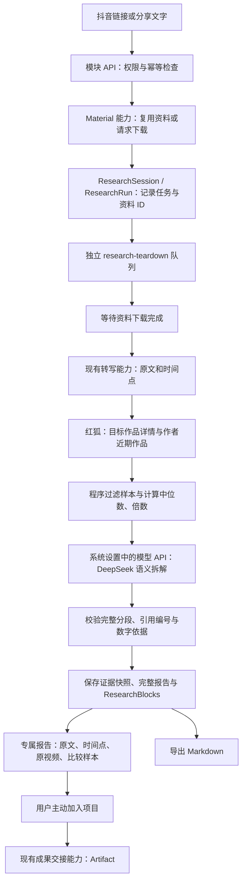

# 抖音作品拆解模块

## 定位与交付边界

**CURRENT IMPLEMENTATION**：入口 `/research/teardown`。这是 Research 中独立的作品拆解模块，保留 Project、Conversation、Material、Research、Skill、Artifact 的产品主线。新增独立页面、报告、API、队列和运行状态；没有新产品中心、模型配置、资料表或数据库 migration。

其他功能页面保持原 UI。Research 导航增加入口；旧会话和研究历史中的拆解结果跳转到专属报告。报告样式只在 `.research-center.is-teardown` / `.teardown-workspace` 内生效，外围应用导航使用原主题。

**CURRENT IMPLEMENTATION**：报告参考用户提供的视觉排版：灰绿色底、白色卡片、蓝紫重点色；左侧私人历史，中间主线/彩色语义时间轴/分段卡片，右侧“做对了什么 / 为什么爆”以总结自然段呈现，去掉编号和角度标签，段首要点加粗，“做对了什么”保留代表性原文与时间点，“为什么爆”按整条作品总结，不挂片段引用。表现数据并入“为什么爆”的开头，原文时间点继续调用已有原视频核对能力。拆解页单独解除研究外层1280px和模块1680px宽度上限，铺满可用画布，左右仅保留14至24px内边距；不改变其他研究页面的居中布局。标题和主线用本机宋体/衬线字体回退，指标、摘要加粗，右栏正文字号14px，理由、时间和原文降低视觉权重。话题标签独立显示，完成报告后的输入框收为“拆解另一条作品”。原文默认按段落折叠，支持逐段/全部展开；时间轴定位对应段落。加入项目入口移到报告顶部，继续调用标准成果交接接口。手机和窄窗口转为纵向排列。

新增展示由 `teardownReportOverview` 从既有报告计算：收藏/赞、分享/赞、评论/赞、转写时长、语义区间和偏离主线占比。点赞为零或数据缺失时比例为 null；偏离区间按转写段落起止时间合并去重，不表示观看留存。样本不足原因紧贴指标，详细口径折叠；Markdown 导出保留新指标及全部原文。旧报告可直接使用新排版，不重新调用模型。

**CURRENT IMPLEMENTATION**：语义色条与“核对主线原文”入口间隔12像素；每段最小宽56像素、高36像素，标签字号12像素并留出内边距。空间不足时仅色条区域横向滚动。宽度按时长分配并设可读性下限，因此不是严格按时间等比的刻度；精确时间以分段起止时间为准。

**CURRENT IMPLEMENTATION**：新任务使用版本6提示词。`analysis.virality` 保存整条作品的独立传播分析；`trendAssessment` 保存有日期来源支持的热点与阶段关联，字段校验、数字证据校验与原文校验共用最多一次修正。`strengths` 回答创作者的表达方法，`virality` 回答受众需求、内容辨识度、情绪、收藏与分享动机、传播适用条件，要求口语化总结，不逐段复述，也不复制前一栏。页面、Markdown 和项目交接均不再将 strengths 用作缺失 virality 的兜底。历史报告提供在原记录更新分析的入口，版本与权限检查保持不变；已交接的 Artifact 快照不会改写。新报告的传播解释不展示片段时间点，结构与原文核对继续保留真实转写时间。没有热点依据必须标记未核实，有限榜单不代表全网或发布阶段的热点。未新增数据库列或迁移。

## 一条链路如何完成



1. 接收分享文字，使用现有抖音 URL 提取和规范化能力。服务端检查当前 Workspace 成员、用户状态和写入权限。相同用户、相同请求标识重复提交得到同一任务；标识用于不同链接则拒绝。
2. Material 适配器查找同 Workspace 的规范化 URL / 视频 ID；已有下载与转写优先复用。否则调用 `createSourceAndJob`，交由已有采集队列执行。研究模块不实现自己的下载器。失败或归档资料先在资料页处理。
3. 任务持久化后派发到独立队列。Worker 对资料未就绪的任务延迟调度，不占用采集队列。文件完成后调用 `requestSourceTranscription`；转写沿用既有本地 FunASR / 豆包配置，与 DeepSeek 文本分析分开。
4. 取得完整、带时间点的 Transcript 后，红狐 `workDetail` 获取目标作品公开互动数据，`accountWorks` 获取作者近期作品。作者标识或样本不足时仍可分析正文，比较报告明确显示缺口。目标详情明确返回“未查询到相关数据 / 优质库暂未收录”或 `REDFOX_EMPTY_DATA` 时，保留已下载资料和转写，继续调用配置的模型生成正文报告；标记 `publicDataStatus=UNAVAILABLE`，互动指标、中位数和倍数为 null，作者比较显示“数据不足，无法比较”。不编造作者或作品标识，不自动追加广域库请求。鉴权、额度、超时、无效响应、未知错误和标识不一致仍按错误处理。
5. 比较数据由程序计算。DeepSeek 只返回主线、连续语义分段、段落作用和有原文编号支持的判断。系统回填原文与起止时间。提示词包含从 Zod 校验合同生成的完整 JSON Schema、字段示例和类型规则，按 [DeepSeek JSON Output 说明](https://api-docs.deepseek.com/guides/json_mode/) 为 JSON Object 请求补齐格式示例。配置支持原生 JSON Schema 的 Provider 时按其现有能力启用。Provider 的 JSON/字段校验与模块的分段、引用、数字依据校验共用至多一次修正；仍不合法则失败，不生成伪完整报告。鉴权、额度等错误不进入格式修正。失败路径、实际模型和 Provider 请求标识保存在 ApiUsage / AIRun，不返回凭证或原始模型响应。
6. 完成时在同一事务保存报告、来源、ResearchBlocks、AIRun 和审计信息。报告自动进入私人研究历史。加入项目必须由用户操作，调用既有 `shareResearchRunToProject`，不自动写入项目。

## 模块接口与数据所有权

| 边界 | 拆解模块使用的能力 | 所属模块 |
| --- | --- | --- |
| 资料准备 | `prepareTeardownMaterial` 适配 `createSourceAndJob` | Material |
| 下载结果读取 | `readTeardownMaterial`，只读取当前 Workspace 资料 | Material |
| 转写请求 | `ensureTeardownTranscription` 适配 `requestSourceTranscription` | Material / ASR |
| 公开数据 | `collectTeardownPublicData` 使用 RedFox 标准 Adapter | Provider |
| 模型加载 | `loadConfiguredLLMRuntime` 使用 IntegrationService 的 Workspace 凭证 | Integration / LLM |
| 证据与报告 | `TimedText`、`TeardownWork`、`TeardownBaseline`、`TeardownReport` | Core / Research |
| 成果交接 | 标准 ResearchBlocks → `shareResearchRunToProject` | Research / Artifact |

纯计算、校验和模板在 `packages/core/src/teardown.ts`，不依赖 Web、数据库、Provider、队列或其他业务模块内部实现。Provider 中只定义结构化模型输出。Worker 的 `teardown/capabilities.ts` 是服务端能力适配边界；`teardown/worker.ts` 只编排该链路与它自己的 ResearchRun 状态。Web 通过模块服务/API 操作任务，不直接驱动模型。

共享模型加载从旧账号研究代码中提取为 Worker 公共能力，旧 `loadBenchmarkRuntime` 保留兼容委托；拆解模块无需导入账号研究实现。普通 Research 的 reserve / execute 接口拒绝接管 `TEARDOWN` 会话，普通研究超时清理也排除此类任务。

**INVARIANT**：报告私有性通过服务端 Workspace、User、Session Creator 与 Requester scope 实现。Worker 重新检查活跃成员与写入权限，发布结果前在事务中再次核对。UI 隐藏和 Prompt 不承担权限检查。API 不返回 Provider 原始响应、凭证、存储对象 key 或推理过程。

## 持久化、恢复和停止

复用 `ResearchSession.entryTemplate = TEARDOWN`。`ResearchRun.coverage.schema = douyin-teardown-v1` 保存资料 ID、输入 URL、转写任务 ID、公开数据快照与最终完整报告；`inputScope`、`blocks`、`sourceRefs` 保持现有 Research / Artifact 合同。没有 Schema 变更。

阶段：`MATERIAL → TRANSCRIPTION → BASELINE → ANALYSIS → COMPLETED`，失败为 `FAILED`。取消使用 `status=FAILED / stage=CANCELLED / errorCode=CANCELLED`，不扩展数据库枚举。

派发失败保留数据库预约；独立/嵌入式 Worker 启动及每30秒扫描待完成拆解，补发遗漏任务。BullMQ 使用稳定 run ID；等待资料通过 delayed job 恢复，模型/目标数据的可重试错误最多3次。已经完成或停止的任务再次投递不产生报告。任务总等待上限45分钟。

取消停止后续拆解与结果发布；正在运行的外部请求可能已经消耗额度，已创建的 Material 任务保留并由原模块管理。失败卡片的“在当前任务重试”调用该任务 `POST /api/research/teardown/{runId}`，保持原页面 URL、ResearchSession / ResearchRun ID 和历史条目，复用已有文件、Transcript 与已取得的公开数据/缺口。旧失败下载需先在资料页重试；失败转写在重试时调用原转写能力重试。新输入仍创建新任务；已完成报告拒绝重试。

重试在行锁中递增已有 `ResearchRun.version`，不增加表或迁移；请求携带当前 version，重复或并发点击只进入同一次重试。旧 AIRun 和 ApiUsage 保留，审计关联旧 AI 尝试。Queue jobId 首次仍为 runId，后续为 `runId-v{version}`；Worker 的读取、进度、失败和发布写入均按 version 隔离，防止取消后尚未返回的旧模型响应覆盖新尝试。每次重试重新计45分钟期限；派发失败仍由持久化任务恢复器按当前版本补发。

模型请求、修正请求、目标详情及作者分页分别记录 ApiUsage。目标接口失败也保存 errorCode、providerCode 和可用的 providerRequestId。模型调用接入现有体验额度限制。队列与现有 Worker mode 租约一同启动/关闭；独立和嵌入式两种模式均已挂载。

**CURRENT IMPLEMENTATION**：私人拆解历史由服务端分页，每页最多8条，不再截断为最近30条；翻页保留当前报告。完成条目只显示日期，不显示“完成”标识；完成报告上方不再显示重复的完成提示，使历史卡片与右侧报告卡片顶部对齐。“查看资料”保留在报告顶部操作区；未完成任务继续显示步骤与状态。历史条目的删除入口使用行内确认，调用 `DELETE /api/research/teardown/{runId}/history`，与原停止任务接口分开。服务端在行锁内核对 Workspace、个人所有权和写权限，只删除对应 ResearchRun 及其空 TEARDOWN 会话，保留 Material、Transcript、AI 调用审计和已经加入项目的 Artifact 快照。正在运行的任务被删除后，Worker 不再发布结果。删除当前记录在原窗口清空报告；删除末页最后一条记录时自动回退到有效页码。

**CURRENT IMPLEMENTATION**：每个阶段持久化 `lastStage`，失败或停止后保留此前完成步骤；旧失败记录按同 Workspace 的资料/转写和 AIRun 恢复可证明的进度。正文报告完成但公共数据缺失时，比较步骤显示“数据不足”，不展示成功勾选。页面、Markdown 和项目成果均说明缺口；页面与导出不会将失败查询时间描述成已经取得的公开数据快照。

## 比较策略与解释边界

**EXPERIMENT**：初始策略最近60天，最多3页、保留60条作品；排除目标作品、重复、已知置顶、作者不匹配、发布日期缺失/越界与缺失点赞。最少20条样本、点赞中位数至少50时才计算目标点赞 / 中位数。页面与导出均展示样本、过滤数、采集时间和公式。

缺失值保持 null；零点赞是有效值。置顶标识未返回时明确说明无法完整排除。采用作者默认发布列表而非点赞排序；达到分页上限时注明覆盖不完整。公开累计点赞有发布时间和曝光偏差，不据此判定“爆款”，也不推断留存、完播、平均观看时长或因果关系。

原文只来自 Transcript。模型用编号引用，时间由程序映射。保留原文内容，不用 AI 改写或词表替换。分析范围最多6万字、2500条转写记录，单记录最多4000字；超范围明确拒绝，不静默截掉后半段。完整报告和导出保留全部获准输入；标准 Research 来源摘要受现有20,000字合同限制，完整原文仍可在专属报告核对。

## 项目创作交接（2026-10-10）

**CURRENT IMPLEMENTATION**：作品拆解的“加入项目”支持搜索已有项目或单独新建项目，并预览实际分享的报告正文。“确认加入”留在报告；“加入并继续创作”进入项目工作台，将报告作为明确的引用依据，不把报告设为改写目标。新建项目与分享在同一事务中完成，重复请求复用项目和报告；失败回滚，版本变化要求重新审阅。

**CURRENT IMPLEMENTATION**：项目 Agent 按服务端权限读取报告快照，多轮改稿和重新打开对话可恢复已发送的报告引用；用户可查看或移除依据。私人研究会话与未分享背景不随项目分享。已有项目中的报告快照不随原研究更新而被覆盖。知识库沿用现有按需检索及权限范围，明确要求检索时结合报告主题，不在每次改稿时重新检索。

**BOUNDARY**：本轮串联现有文本创作能力，可用于口播稿、文案和配图建议；实际图片生成仍是 **CURRENT IMPLEMENTATION GAP**，没有新增图像 Provider 或数据库结构。

**VERIFICATION**：本轮5个文件29项定向测试、1项浏览器验收通过，Web typecheck与修改文件lint通过，覆盖原子创建、重复请求、失败回滚、版本冲突、权限、模型收到报告正文、多轮引用、移除依据及按需组合知识库。浏览器检查桌面与390像素布局，生成回答使用本地模拟流；服务测试使用模拟模型和知识库，没有发起真实模型、红狐、ASR或知识库外部调用。未执行数据库迁移、全仓构建或全量验收，未暂存、提交或推送。

## 参考仓库

参考 [zinan92/douyin-teardown](https://github.com/zinan92/douyin-teardown/tree/10f9522d5ea076535165a5d527167b5971bfa748)，固定版本 `10f9522d5ea076535165a5d527167b5971bfa748`。该仓库是 CLI / Skill，并没有可直接移植的网站前端；本模块借鉴它的报告信息结构，适配为自己的网页。

保留数据、主线一句话、分段时间轴、做对了什么、逐段原文、解释边界和七种语义标签。按用户要求增加“为什么爆”的传播机制分析，原来的负面分析归入“主线风险”；公开表现与原文共同支持分析假设，不据此证明传播因果。没有真实创作者后台数据时不展示平均观看时长。没有搬入下载/签名算法、cookies、仓库的模型配置或第三方代码。模板参考的授权声明见 `teardown-reference-license.txt`。

## 验证与运行

**CURRENT IMPLEMENTATION**：V2 定向验收包括纯计算/校验、临时用户与隔离测试库中的链路状态、权限/取消/幂等、ResearchBlock 校验和 Artifact 交接；相关账号研究、会话和成果测试一并回归。浏览器验收覆盖报告阅读、样本表、时间点提示、导出、加入项目、旧入口跳转、私人报告404及1440/1024/390布局。

2026-10-09 模型结构与原地重试修复：本次定向运行 core / teardown-chain 共23项及 OpenAI-compatible 本地 HTTP fixture 27项测试、1项浏览器验收，通过。覆盖实际模型 Adapter 首次无效 JSON/缺失字段后修正、最多一次修正、失败诊断、同任务并发重试、旧版本失败/结果隔离、Redis 新版本派发、45分钟期限重置、报告/原文导出、权限和同窗口/同 URL/同任务数量。Provider fixture 单独在 LOCAL_TEST 下允许其本地测试请求；第一轮外部调用禁用开关阻止 fixture 的失败已定位并在正确的 fixture 环境重跑通过，没有放宽实际系统边界。Worker / Web typecheck 与修改文件 lint 通过。

2026-10-09 历史删除与分页：本轮21项 teardown-chain 测试及1项浏览器验收通过，覆盖超过30条历史、每页4条、页码回退、删除确认和取消、私人权限、资料/项目成果保留、在途结果停止发布，以及当前记录删除后同窗口空态。Web typecheck 和修改文件 lint 通过；本轮没有发起真实模型、红狐或 ASR 请求，没有删除用户实际历史。

2026-10-09 报告视觉重排：本轮 core / teardown-chain 共28项测试及1项浏览器验收通过，覆盖比例空值/零分母、偏离区间去重、新指标导出、默认折叠/全部原文保留、彩色时间轴定位、标题话题分离、样本不足说明、项目交接、既有原地重试/分页删除，以及1680/1440/1024/390宽度和浅色/深色主题可读性。修改文件 lint 与最终 Web / Worker typecheck 通过；本任务未修改飞书模块。本轮沿用原配置重启3022，健康接口200且三个任务队列各一个 Worker 就绪。未调用真实模型/红狐/ASR，未删除用户历史或重生成已有报告。

2026-10-09 色条可读性与传播分析：本轮 core / teardown-chain 共31项测试、1项浏览器验收通过，覆盖传播分析结构和原文/数字证据、百分比格式化、历史优点兼容、导出及项目交接；浏览器使用九个时长悬殊的段落检查1440/390宽度下的最小尺寸、完整标签、入口间距、局部横向滚动及段落定位。Web / Worker typecheck 与修改文件 lint 通过。沿用原配置重载3022，健康接口200且三个队列各一个 Worker 就绪。本轮未请求真实模型/红狐/ASR，未重生成用户已有报告，未执行数据库迁移。

2026-10-09 历史列表调整：本轮定向分页 Service 测试1项及浏览器验收1项通过，覆盖每页8条、33条记录完整分页、末页删除回退、17条记录的三页浏览、完成标识移除、桌面卡片顶部对齐和手机翻页/删除。首轮浏览器测量早于页面渲染，补上色条按钮就绪等待后重跑通过。修改文件 lint 通过，3022健康接口200。未运行本轮全仓 typecheck、build 或全量测试，未修改用户实际历史、模型报告和数据库结构。

2026-10-09 全画布与口语化总结：本轮 core / teardown-chain 共31项测试、浏览器验收1项通过，覆盖新提示词的整条作品总结要求、证据与百分比校验、总结段落导出、引用时间点核对，以及2560/2048/1680/1440/1024/390宽度下的画布占用、原文折叠、左右对齐和既有分页删除。最终引用左对齐样式已重跑浏览器验收。Web / Worker typecheck 与修改文件 lint 通过；没有新增数据库字段或迁移，没有自动重写历史模型结论。等待用户在途任务结束、确认三个队列空闲后沿用原配置重载3022，健康接口200且三个 Worker 均就绪，版本5提示词已加载。本轮没有人工发起真实模型/红狐/ASR 调用；未运行全仓构建和全量验收。

标准复现：在满足 `packages/db/src/test-target.ts` 的 `LOCAL_TEST` 环境执行：

```powershell
node node_modules/vitest/vitest.mjs run packages/core/src/teardown.test.ts apps/web/tests/teardown-chain.test.ts apps/worker/src/benchmark-analysis.test.ts apps/web/tests/research-sharing.test.ts apps/web/tests/research-session.test.ts apps/web/tests/research-blocks.test.ts --no-file-parallelism
node node_modules/@playwright/test/cli.js test --config apps/web/playwright.teardown.config.ts
node node_modules/typescript/bin/tsc -p apps/worker/tsconfig.json --noEmit
node node_modules/typescript/bin/tsc -p apps/web/tsconfig.json --noEmit --incremental false
```

**CURRENT IMPLEMENTATION**：2026-10-09 按用户要求重启了现有3022 live 服务，沿用原配置。健康接口返回200，数据库、对象存储和后台均就绪；采集、转写、拆解队列各有一个 Worker。登录页返回200，未登录访问拆解页面跳转登录，拆解 API 返回401。任务入口在 Worker 禁用或拆解 Worker 未就绪时给出明确提示。

**CURRENT IMPLEMENTATION**：2026-10-09 的真实任务已完成红狐下载和豆包转写（20段）；目标详情返回“优质库暂未收录”，模型尚未调用。本次以该返回文本和缺失作品 ID 的形态加入隔离回归，验证继续生成报告、保留原文/时间点、导出与 Artifact 交接。

**CURRENT IMPLEMENTATION**：按本轮用户要求重启3022 live，并在用户最新模型结构失败的原任务内进行真实重试。配置的 `deepseek-flash` 成功返回并保存报告，完整保留20段转写，拆分为5个语义段落；原任务/会话/资料 ID 保持一致，公开数据缺失继续明确标注。此次复用已下载视频、豆包转写与已有红狐缺口，不重复发起红狐或 ASR 请求。系统健康接口200，三个队列 Worker 均就绪。

**CURRENT IMPLEMENTATION GAP**：真实红狐作者分页及有有效样本的比较仍待在线验收。重启沿用已启用后台与外部调用的 live 配置，不更改 daily / review 限制。

未运行全仓构建、全量 E2E 或正式发布验收；未改权威治理文档，未执行数据库迁移，未暂存/提交/推送。

## 2026-10-09 长视频转录衔接

**CURRENT IMPLEMENTATION**：转录能力仍归 Material/Worker 所有；Research 仅读取完整 Transcript 和安全进度摘要。长流式音频、本地长音频及超过整文件上传范围的极速版音频使用三分钟分片、一秒重叠、受限并发和失败检查点；同资料重试只补转未保存的片段。极速资源必须明确配置并有账号授权，权限失败回到原接口。没有新增 Model、数据库迁移或第二套下载/转录入口。

**CURRENT IMPLEMENTATION**：资料页及拆解页显示已完成/总片数和正在重试的片段；私有检查点和配置不传给浏览器。ASR 时间偏移映射回原音频，未完成的结果不覆盖旧 Transcript，未返回时间戳的本地输出不伪造时间。等待 Material 转录不消耗报告的45分钟处理预算，同时转录等待自身保留7小时上限。既有6万字符/2500记录的报告范围限制继续明确报错，不截断原文。

**VERIFICATION**：91项转录策略、检查点、报告链路、范围隔离及配置定向测试通过；9项真实FFmpeg/本机对象存储/队列/模拟识别接口集成测试、6项FFmpeg测试及26项识别协议测试通过。超过20MiB音频验证了尾片失败后保留前三片、显式重试只调用一次识别；中断检查点可在原执行锁内恢复，在途音频不会被保留期清理。浏览器验收1项通过，覆盖新进度与检查点隐私并复核既有报告/分页/原窗口重试。Web、Worker、Integrations typecheck及改动文件lint通过。未运行全仓build/全量测试，未人工重新调用用户真实ASR或DeepSeek。

**CURRENT IMPLEMENTATION GAP**：本账号2026-10-09已留存的极速版核验返回资源未授权；本轮没有变更凭证或强行切换接口。系统当前使用已配置接口的分片能力，极速识别需服务商开通资源后填写高级配置。长篇章节报告及标准录音文件异步任务的持久提交/查询恢复仍未实施，详见[转录说明](../production-transcription.md)。

**CURRENT IMPLEMENTATION**：确认三个live队列空闲后，于18:01重载原3022服务，无新浏览器窗口。公开就绪接口返回200，configuration/database/storage/background均为true。Git保持未暂存、未提交。
## 2026-10-09：独立传播分析与视频画面预览

- CURRENT IMPLEMENTATION：“做对了什么”总结创作者的表达方法；“为什么爆”独立分析整条视频的受众需求、内容辨识度、情绪、收藏与分享动机、传播适用条件。右栏传播分析不再展示片段时间点，不再以 strengths 填充缺失的历史 virality。
- CURRENT IMPLEMENTATION：新增热点与阶段关联。复用同工作区24小时内的全球热点快照，缺少时最多一次红狐今日热点请求（15秒）。保留采集时间与榜单窗口；失败或无数据不阻断内容分析，模型只能标记未核实。来源编号和 RELATED 结论由服务端校验，不允许把常见题材直接称为当下热点。
- CURRENT IMPLEMENTATION：报告可在原 ResearchRun 更新分析，使用配置模型，复用 Material 转写与已取得的比较数据；版本与权限检查阻止并发覆盖，不新增历史记录或窗口。更新过程中保留先前报告快照，成功后替换，既有项目成果仍保留原快照。
- CURRENT IMPLEMENTATION：这次实测原视频为 3840×2160 HEVC，音频为 AAC；不是转写覆盖原件。Material 使用 FFprobe 检查真实视频轨道；H.264/yuv420p MP4 可复用，不兼容编码另存 H.264/AAC、1280×720边界内的等比预览，验证画面、编码和时长。原 VIDEO、派生预览 VIDEO 与转写 AUDIO 分别保存。转写处理及报告预览入口都复用该能力，资料页优先显示匹配原件的预览、下载仍指向原件。纯音频不能冒充视频。
- CURRENT IMPLEMENTATION：兼容等值数字格式（35%与35.0%），仍拒绝虚构数字；模型传播条目的多余字段丢弃，不写入报告。保留结构、原文、数字与热点证据校验，以及最多一次模型修正。
- CURRENT IMPLEMENTATION GAP：热点榜单覆盖有限，无法据此确认全网热点，更不能倒推作品发布阶段。内容报告仍基于转写，未接入视觉或创作者后台数据；“为什么爆”为传播解释，不是已验证因果。首次生成不兼容视频的预览需要转码，之后缓存复用；没有画面的文件需重新获取原视频。
- VERIFICATION：定向报告/权限/原窗口更新/资料读模型/转写状态测试50项通过，真实 FFmpeg 与转写集成测试16项通过，浏览器验收1项通过（H.264解码、真实红色画面像素、无新增窗口、历史8项分页及响应式报告）。修改文件 lint 与相关类型检查通过；未执行全仓 build、全量测试或 migration。
